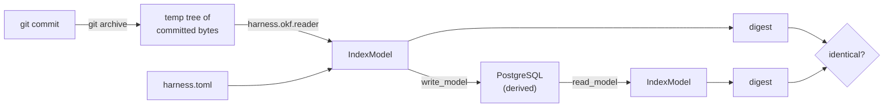

# Extraction and index

> ID: HARNESS-EXTRACT-001
>
> Status: **Implemented** — build-order step 1 of `HARNESS_ARCHITECTURE.md` §9.
>
> Authority: a design document. It records how step 1 was built. It creates no
> decision status; the decision it implements is `ADR-2026-006`.

---

## 1. What this is

Build-order step 1, "extraction + index": parse document frontmatter, tables and
links into a normalized model, load that model into PostgreSQL, and *prove* the
database is a derived artifact by dropping it and rebuilding from git.

Two rules from the architecture are load-bearing here:

> §4 — **Use the model once to build the deterministic artifact. Never in the
> extraction path.**

> §5.1 — **Postgres may be destroyed and rebuilt from git at any time, and the
> rebuild must produce an identical index.**

Neither the model nor the harness writes a fact. Extraction reads committed bytes
and derives; the index stores what extraction derived.

## 2. Shape

| Module | Role |
|---|---|
| `harness/extract/model.py` | the frozen model and `model_digest` |
| `harness/extract/documents.py` | headings, links, markdown tables, routing fields |
| `harness/extract/source.py` | committed git bytes → model |
| `harness/index/schema.py` | the DDL |
| `harness/index/store.py` | `write_model` / `read_model` / `reset` |

## 3. Parsing is reused, not reimplemented

`harness.okf.reader` is tested and OKF v0.2 conformant, so extraction sits on top
of it rather than parsing markdown again:

* `Bundle` / `Concept` supply type, title, status and frontmatter;
* `Concept.links()` and `Bundle.resolve_path` supply link resolution;
* the harness's own markdown-table pattern (header row + separator row) is
  generalized, keeping the property that matters: **column identity comes from
  the header, never from position.** A register whose column order changes must
  not silently shift which value a column means.

## 4. The source is committed bytes, not the working tree

Git is the source of truth and Postgres is derived, so extraction reads the
*committed* content. `git archive <rev>` is materialized into a temporary
directory, which is handed to the tested reader.

This gives three properties by construction, each with a test:

| Property | Why it matters |
|---|---|
| An uncommitted edit is invisible | the index cannot encode a fact git does not hold |
| An untracked file is invisible | the index is a function of the repository, not the directory |
| A pinned revision is reproducible | the same `rev` always yields the same digest |

The temporary tree is a *rendering* of committed bytes. It is not a source of
truth, and nothing is written back to it.

## 5. The invariant, and why it is not vacuous

The digest is SHA-256 over a canonical JSON rendering (`sort_keys`, no
whitespace variance, documents sorted by path). `read_model` reconstructs a model
**from the rows alone** — it never reads the filesystem or git — so a fact that
failed to round-trip changes the digest.

A test that compared two empty models would pass while proving nothing. The
invariant test therefore also asserts:

1. the model is non-empty (documents *and* registry tables);
2. the rebuild is identical table-by-table, not only by digest;
3. a committed change **breaks** the equality — without this, the invariant could
   hold while indexing nothing;
4. an uncommitted change does **not** break it.

The negative control was also run by hand: corrupting one stored field changed
the digest (`73c167aa…` → `f1b349f5…`), confirming the comparison can fail.

## 6. Git-only input

Three rules keep the index from becoming a second author:

* the only writer is `write_model`, and it writes a model that came from git;
* the schema holds extracted values and build provenance (`commit_sha`,
  `model_version`, `schema_version`, `digest`) — nothing else;
* only keys in `ROUTING_FIELDS` are indexed. Indexing arbitrary frontmatter would
  duplicate the document into the index and invite drift.

## 7. Project-agnostic

Every project-specific value comes from `harness.toml`:

* the bundle root is `[paths] knowledge`;
* registry files are the configured `[registries.*] path` values — the harness
  never guesses which documents are registries;
* `[identity] name` is recorded as the model's project.

Paths resolve from the invoking directory (`Path.cwd()`), never from
`Path(__file__)`. Resolving a caller's context from the library's own location is
the defect this repository has hit more than once; `repo_root` is kept identical
to `guards/session.py` and `entries/commits.py` on purpose.

## 8. PostgreSQL is optional

`psycopg` stays an optional extra. Importing `harness.index` without it is fine;
calling `connect` is not. There is **no default DSN** — the harness must not
guess a database location any more than it guesses a document path. The index
tests skip cleanly when no DSN is supplied, so the derived, optional layer is
never the reason CI fails.

The CLI exit code is `3` when PostgreSQL is unreachable, matching the existing
contract that a non-zero code names a condition rather than a crash.

## 9. What is deliberately not here

| Not built in step 1 | Why |
|---|---|
| The query API (step 2) | next in the build order; the index is its substrate |
| A schema for arbitrary frontmatter | would duplicate the document and invite drift |
| Any asserted PostgreSQL version | no authoritative document fixes one; recorded as `DecisionRequired` |
| An index of uncommitted work | git is the source of truth; uncommitted work is not a fact yet |

## 10. Change history

| Version | Date | Change |
|---|---|---|
| v1.0 | 2026-10-13 | Build-order step 1 implemented: extraction, derived index, rebuild invariant. |
