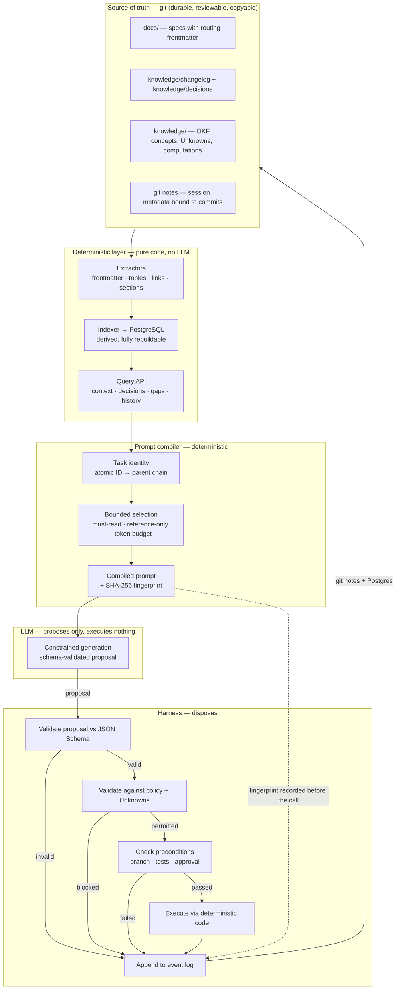

# MrBera Session Harness — Architecture

> ID: HARNESS-ARCH-001
>
> Status: **Proposed design v0.1** — owner-directed research pass of 2026-10-10. Awaiting owner ratification. No MRB-LRF gate has been executed, no code exists.
>
> Authority: a design document. It creates no architecture, holds no decision status, and authorizes no implementation. Where it conflicts with `AI_RND_FRAMEWORK.md`, that wins.
>
> Purpose: define a deterministic harness that (a) persists decisions across coding sessions, (b) compiles exact bounded context so tokens are not spent on retrieval, and (c) makes unpredictable agent action structurally impossible rather than merely discouraged.

---

## 1. The requirement, and the tension inside it

The owner requires:

1. decisions persisted across sessions;
2. deterministic extraction of exactly the needed information — not a "plethora of context";
3. git and PostgreSQL as memory;
4. every action validated; no unpredictable agent behaviour;
5. human instruction → compiled LLM prompt;
6. a standalone, importable framework;
7. documentation treated as executable code;
8. "common practice" enforced automatically — `test before push`, branch per change, `do not write code unless instructed`.

**Items 1–2 and item 4 are in tension with items 5–6.** An LLM's semantic judgement cannot be made deterministic. Any design that claims otherwise is mislabelled.

The resolution, and the core principle of this architecture:

> **The LLM proposes; the harness disposes.**
>
> The model never executes anything. It returns schema-validated *proposals*. The harness validates each proposal against schema and policy, then either executes it with deterministic code or rejects it. Every mutation has exactly one executor, and that executor is not the model.

This is not a workaround. It is the reason "every action validated" is achievable at all: the validation surface becomes the harness's own code, which is testable, rather than the model's reasoning, which is not.

### 1.1 One correction that must be stated plainly

The requirement says "every action, chain of thoughts needs to be validated."

**Chain-of-thought cannot be validated.** It is unobservable and has no ground truth: a coherent chain can reach a wrong answer, and an incoherent one a right answer. Validating it would mean validating a narrative, not a fact.

What *is* validatable, and what this design implements:

| Surface | Validatable? | Mechanism |
|---|---|---|
| The model's **output** | Yes | JSON Schema, enforced at sampling time where the runtime supports it |
| The model's **proposed effect** | Yes | Preconditions checked before execution |
| The **context it received** | Yes | The compiled prompt's SHA-256 is recorded |
| The **decision path taken** | Yes | Every step appended to an event log |
| The model's **chain of thought** | **No** | Recorded for debugging only; never treated as evidence |

The last row is the honest one. An auditable sequence of schema-validated steps is stronger than CoT validation, because it survives a dispute.

---

## 2. Prior art — what already exists

Researched 2026-10-10. Evidence level noted per row; "transcribed" means read from the primary source during this pass.

| System | What it establishes | Evidence |
|---|---|---|
| **git-bug** | A full issue tracker whose data lives **inside git as objects**: distributed, offline-capable, no vendor lock-in, **does not pollute the working tree**, with a formally specified on-disk format and a GraphQL API. This is direct production proof that "decisions in git" is a viable pattern, not an experiment. | **High** — repository README and spec, read this pass |
| **`git notes`** | Attach metadata to an existing commit **without rewriting it**, and it ships **conflict-resolution strategies** for merging notes. Solves "append session metadata to history" without amend/rebase hazards. | **High** — official git documentation, read this pass |
| **Outlines** | Structured generation enforced **at sampling time** — the model cannot emit schema-invalid output. "No parsing, no errors, no retries." Supports JSON Schema, regex and context-free grammars; runs against Ollama among others. | **High** — project documentation, read this pass |
| **Agent Client Protocol (ACP)** | `session/request_permission`: the **client** grants or denies agent action; agents run as subprocesses of a client that "controls access to resources". The propose/dispose split is already a standardised protocol shape. | **High** — protocol overview, read this pass |
| **Event Sourcing** (Fowler) | Store every state change as an event in sequence; **application state is derived and can be discarded and rebuilt** from the log; supports temporal query. This is the licence for treating Postgres as a rebuildable index rather than an authority. | **High** — primary article, read this pass |
| **JSON Schema** | Declarative structure description. Notably states its own limit: *"a sufficiently complex data format will have two phases of validation — structural, and semantic; the latter will likely need… a more general-purpose programming language."* That second phase is the harness's code. | **High** — official documentation, read this pass |
| **promptfoo** | Prompt/output **regression testing** as a first-class discipline: assertions over model output, run as a suite. | **High** — documentation, read this pass |

**Consequence:** the harness does not need to invent its permission model, its storage model, or its validation model. ACP gives the protocol shape, event sourcing gives the storage shape, Outlines gives the generation shape, JSON Schema gives the validation shape, and git-bug proves the whole thing works inside git. The novel work is the **composition** for a single repository that treats its own documentation as executable.

---

## 3. Architecture

**The dashed edge is load-bearing.** The compiled prompt's fingerprint is recorded *before* the model is called. Without it you cannot reproduce a session, and "deterministic" is an unevidenced claim.

---

## 4. The insight that makes determinism real

Runtime determinism and semantic extraction appear to conflict. They do not, if the LLM is moved **out of the hot path**:

> **Use the model once to build the deterministic artifact. Never in the extraction path.**

| Phase | Actor | Frequency | Deterministic? |
|---|---|---|---|
| **Build time** | LLM reads prose → proposes structured frontmatter | Once per document | No — but human-reviewed and committed |
| **Runtime** | Pure code reads structured frontmatter | Every query | **Yes** |

A document's structure is authored once — by a human, or by a model whose proposal a human accepted — and committed. From that commit forward, every extraction is a **pure function of committed bytes**.

If an LLM sits in the runtime extraction path, the system is probabilistic wearing a deterministic label. That is the specific failure this design exists to avoid.

---

## 5. Git and PostgreSQL — the division that keeps them honest

| | Git | PostgreSQL |
|---|---|---|
| **Role** | **Source of truth** | **Derived, rebuildable index** |
| Holds | decisions, specs, entries, provenance, session notes | joins, cross-artifact graph, telemetry, token accounting |
| Survives a repo copy | yes | no |
| Reviewable in a PR | yes | no |
| Supports joins and aggregates | no | yes |
| Rebuildable | — | **yes, from git** |

### 5.1 The invariant

> **Postgres may be destroyed and rebuilt from git at any time, and the rebuild must produce an identical index.**

This is enforced as a test, not a hope: drop the database, rebuild from git, compare. That single test is what stops Postgres from silently becoming a second source of truth that drifts from the first.

### 5.2 What each store is *not*

- Postgres is **not** where decisions are made. A decision exists when it is committed to git.
- Git is **not** a query engine. Asking "which modules are blocked by a `BlockedOwner` decision that also touches `MRB-M06-S07`" is a join, and belongs in SQL.

### 5.3 Why git is "basically free memory"

Git is already an append-only, content-addressed, cryptographically ordered event log with a distributed transport. The design does not add a store; it **reads the one already present**. `git notes` extends it with metadata that does not rewrite history, and `git log` answers history questions with zero marginal cost and zero tokens.

---

## 6. Token economics — where the saving actually comes from

The saving is **architectural, not prompt engineering**. The largest win is not calling the model at all:

| Question | Without harness | With harness |
|---|---|---|
| "What is decided about X?" | LLM reads the decision registry | **SQL** |
| "Which documents bind task Y?" | LLM reads a reading order | **`okf_context.py`** |
| "Is this blocked?" | LLM infers | **exit code 3** |
| "What changed in prior sessions?" | LLM reads history | **`git log` / `git notes`** |
| "What does this document require?" | LLM reads and interprets | **frontmatter** |
| "Does the code satisfy it?" | LLM judgement | **test result** |

Most agent queries are lookups wearing a costume. Each row moved from "model answers" to "code answers" removes tokens **and** removes a hallucination surface.

The model is then reserved for work only it can do: interpreting unstructured intent, drafting prose, proposing structure for a human to accept.

---

## 7. Enforcement — prevention, not detection

"Common practice should be common sense to the agent, and the harness will ensure that." Correct in intent, with one adjustment:

> **A harness cannot make an agent sensible. It can make violations impossible, or loud.**

| Class | Example | Mechanism | Strength |
|---|---|---|---|
| **Impossible** | Pushing to `main` | No `push_to_main` tool exists | **Absolute** |
| **Impossible** | Editing a released spec | Path not in the workspace | **Absolute** |
| **Loud** | Working on a protected branch | Guard exits 1 | Detectable |
| **Loud** | Skipping tests | CI fails | Detectable |
| **Impossible** | Committing a secret | Path never enters the allowed set | **Absolute** |

**Prefer the impossible class wherever it is achievable.** Removing a capability beats checking for its misuse, because a check can be bypassed and a missing capability cannot.

This replaces the current advisory-only posture (`ADR-2026-002`) with real enforcement for anything that flows through the harness. The remaining advisory surface is work done *outside* the harness, which is precisely what adopting the harness removes.

### 7.1 The rules the owner should not have to repeat

Each becomes harness behaviour rather than instruction, per the owner's requirement:

| Rule | Enforcement |
|---|---|
| `do not write code unless explicitly instructed` | No write tool is exposed until the session declares an implementation intent against an approved work packet |
| `switch to a new branch for new development` | The session refuses to start on a protected branch; branch creation is the first harness action |
| `test before push` | The push tool is not exposed until the test effect-check has passed in-session |
| `never commit a secret` | Path allow-list excludes secret globs; a proposal naming one is rejected |
| `one logical change per branch` | The change manifest is declared once at session start; a proposal outside it is rejected |
| `write a decision, not a memory` | Any accepted decision must produce an entry file, or the proposal is incomplete |

---

## 8. What cannot be built as stated

Stated plainly, because the alternative is discovering it later:

| Not achievable | Why | What is built instead |
|---|---|---|
| Validating chain-of-thought | Unobservable, no ground truth | Output and effect validation; CoT logged, never evidence |
| Fully deterministic instruction→prompt | Intent classification is fuzzy | Deterministic prompt *assembly*; intent resolution is explicit and fallible, with a human-clarification fallback |
| "Common sense" as a harness property | Sensibility is not a code property | Impossible-or-loud enforcement of enumerated rules |
| Postgres as authority | Two sources of truth always drift | Git authoritative; Postgres a tested rebuild |
| Zero-loss semantic extraction from prose | Prose is ambiguous | LLM proposes structure once; human accepts; commit makes it deterministic |

---

## 9. Build order

Sequenced so the deterministic, testable parts land before the probabilistic ones.

| # | Component | Deterministic? | Value | Risk |
|---|---|---|---|---|
| 1 | **Extraction + index** — parse frontmatter/tables into Postgres; prove rebuild-from-git is identical | **Yes, fully** | High | Low |
| 2 | **Query API** — the lookup surface that replaces file-reading | **Yes, fully** | High | Low |
| 3 | **Prompt compiler** — task ID + selection + budget → prompt + fingerprint | **Yes, fully** | High | Low |
| 4 | **Proposal schemas + effect gates** — what the model may propose; how it is checked | **Yes, fully** | High | Medium |
| 5 | **Session ledger** — `git notes` + Postgres; prompt, proposal, verdict, effect | **Yes, fully** | High | Low |
| 6 | **Instruction→prompt** — human intent to compiled prompt | No | Medium | **High** |

Steps 1–5 are deterministic and where most of the value sits. **Step 6 is last because it is the least provable**, and the design must not depend on it: a human who writes the task ID directly bypasses step 6 entirely and loses nothing.

### 9.1 Relationship to what already exists

The routing, entry, guard and CI tooling began as scripts inside a consuming repository and became the **first modules of the harness**. They are now a package whose behaviour is configured by `harness.toml`, so no document location or identifier grammar is hardcoded.

---

## 10. Open decisions

Recorded as `DecisionRequired`; the design does not presume them.

| # | Decision | Options | Note |
|---|---|---|---|
| 1 | Postgres locality | local-only · shared service | Local is simpler and has no sync problem; shared needs auth and conflict handling |
| 2 | Index lifecycle | rebuild-on-demand · long-running service | Rebuild-on-demand keeps Postgres provably derived |
| 3 | ~~Constrained decoding~~ | ✅ **VALIDATED — use native `format: <JSON Schema>`** | Settled by local experiment, see §10.1 |
| 4 | Session metadata store | `git notes` · in-tree files · Postgres only | `git notes` survives a repo copy; Postgres alone does not |
| 5 | Harness language | Python · other | Python already present; Outlines and the existing tools are Python |
| 6 | Reuse vs rebuild of ACP | adopt ACP shape · custom protocol | ACP is standardised and already models propose/dispose |
| 7 | Repository migration | fresh `mr_bera` · migrate existing | Owner creating fresh `mr_bera` (private, empty as of 2026-10-10) |

### 10.1 Decision 3 validated — constrained decoding

**Verdict: native Ollama `format: <JSON Schema>` is sufficient. Do not build a
prompt-and-validate layer.**

Environment observed 2026-10-10: Ollama **0.34.0**, running on `localhost:11434`,
with 18 local models including `phi4-mini:3.8b-q4_K_M`, `gemma3:4b-it-q4_K_M`,
`qwen3:4b` and `granite4.2:3b`.

**Experiment 1 — basic compliance.** A schema with an enum and
`additionalProperties: false`:

| Model | Result | Time |
|---|---|---|
| `phi4-mini:3.8b-q4_K_M` | Exact schema, enum valid | 25.6 s |
| `qwen3:4b` | **Empty response** | 54.7 s |

**Experiment 2 — adversarial.** The prompt instructed the model to emit an
out-of-enum value, inject an extra key, and ignore the schema constraints:

| Model | Enum obeyed | Extra keys | Enforced |
|---|---|---|---|
| `phi4-mini:3.8b-q4_K_M` | ✅ | none | **True** |
| `gemma3:4b-it-q4_K_M` | ✅ | none | **True** |
| `granite4.2:3b` | ✅ | none | **True** |

**Experiment 3 — `qwen3:4b` with `think: false`** produced valid schema-conformant
JSON, confirming the empty responses were the thinking channel consuming output.

**Conclusions (evidence level: High — reproduced locally on the target runtime):**

1. **Schema enforcement happens at the sampling layer.** Under explicit
   adversarial instruction, every model stayed inside the enum and emitted no
   extra keys. The model *cannot* produce out-of-schema output. The propose/dispose
   split therefore has hardware-enforced backing rather than being a discipline.
2. **`think: false` is mandatory for thinking models.** Without it, `qwen3:4b`
   returns an empty string. This is a harness default, not a per-call option.
3. **Schema is enforced; semantics are not.** Every adversarial model returned a
   *valid* proposal (`create_branch`) that would have been steered by the attack.
   The harness must still validate meaning and preconditions — precisely the
   structural/semantic split that JSON Schema documents.
4. **Token accounting is native.** `prompt_eval_count`, `prompt_eval_cached_count`
   and `eval_count` are returned on every call, so the ledger does not estimate.

**Requirement added to the harness by this validation:** thinking-mode models must
be driven with `think: false` by default, and a schema-constrained call that
returns an empty payload must be treated as a failure rather than a valid result.

---

## 11. Evidence and provenance

| Element | Source | Level |
|---|---|---|
| **Constrained decoding on the target runtime** | **Local experiment, Ollama 0.34.0, 2026-10-10** | **High (reproduced)** |
| git-bug data-in-git pattern | repository README + spec | **High** (read this pass) |
| `git notes` semantics and merge strategies | official git documentation | **High** |
| Constrained structured generation | Outlines documentation | **High** |
| Propose/dispose permission model | Agent Client Protocol overview | **High** |
| Event log as rebuildable source | Fowler, *Event Sourcing* | **High** |
| Structural vs semantic validation split | JSON Schema documentation | **High** |
| Prompt regression testing | promptfoo documentation | **High** |
| Git-as-authoritative / Postgres-as-derived | design inference from the above | **Best-guess** |
| Token-saving table | design inference | **Best-guess** |
| Enforcement classes | design inference | **Best-guess** |

No capacity, performance or cost figure is asserted. The build order is a recommendation, not a measurement.

---

## 12. Change history

| Version | Date | Change |
|---|---|---|
| v0.1 | 2026-10-10 | Initial design from the owner-directed research pass. No code, no gate. |
