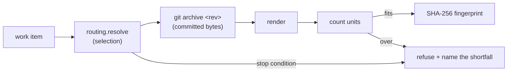

# Prompt compiler

> ID: HARNESS-COMPILE-001
>
> Status: **Implemented** — build-order step 3 of `HARNESS_ARCHITECTURE.md` §9.
>
> Authority: a design document. It records how step 3 was built. The decision
> about the budget unit is `ADR-2026-010`.

---

## 1. What this is

Build-order step 3: *task ID + selection + budget → prompt + fingerprint*. A
work item in, a bounded prompt and a SHA-256 fingerprint out. Deterministic — no
model, no clock, no network.

Three properties make it deterministic rather than probabilistic wearing a
deterministic label:

1. **A pure function of a committed revision.** Selection comes from
   `harness.routing.resolve`; text comes from the same `git archive` materialization
   `harness.extract.source` uses. Neither reads the working tree.
2. **The fingerprint binds the content.** SHA-256 over the prompt text *and* the
   manifest of which documents are in it.
3. **Refusal instead of truncation.** An over-budget or blocked work item fails
   with a named finding. The compiler never emits a silently-partial prompt.

## 2. Shape

## 3. The fingerprint is the audit handle

`HARNESS_ARCHITECTURE.md` §3 draws a **dashed edge** — the prompt's fingerprint is
recorded *before* the model is called — and calls it load-bearing:

> Without it you cannot reproduce a session, and "deterministic" is an unevidenced
> claim.

The compiler is that edge made executable. The fingerprint covers:

- the prompt text,
- the work item and revision,
- the **manifest** of every entry: concept id, path, title, read budget, trust
  tier, status, staleness, coverage and per-entry unit count.

Hashing the text alone would let a same-length document be substituted without the
digest changing. Including the structure closes that, and a test asserts it.

The prompt goes to **stdout**, the fingerprint to **stderr**, so a caller can
capture either without the other, and a manifest that omits the text is available
with `--manifest` — the audit record should not duplicate the thing it audits.

## 4. The budget: no invented threshold

`budget` is a **required** argument with **no default**. No authoritative document
fixes a value, and a default would be an invented threshold that every recorded
fingerprint silently depended on. The caller supplies it, it is recorded in the
manifest, and — because it bounds admissibility rather than content — it does
*not* enter the fingerprint. A generous budget and a tight one compile the same
prompt.

The unit is a **word** count, named in `harness.compile.tokens.UNIT`. It is exact
and provider-independent, which is what a reproducible fingerprint needs. It is
*not* a model's tokens — that count depends on the provider, and choosing one
would make the budget mean different things per provider. See `ADR-2026-010`.

## 5. Refusal, not truncation

| Condition | Exit | Why not truncate |
|---|---|---|
| The item is blocked | `3` | the blocker must be recorded, not worked around |
| Nothing covers the chain | `4` | no grounding at all; record `BlockedDependency` |
| Over budget | `5` | dropping documents asserts they do not bind the work item |
| Usage error | `2` | bad identifier or non-positive budget |

Over budget is deliberately **all-or-nothing**. A silently-shortened prompt is a
false claim about what binds the work item, and the failure is invisible: the
model answers confidently from partial context. `harness context` remains
available for discovery, where the caller chooses what to read.

`--defining` is passed through to the resolver, so a concept whose
`do_not_use_for` names a state the caller intends to define is **reported as
excluded** in the manifest rather than quietly dropped.

## 6. Verified

- 35 compiler tests, 9 CLI tests; determinism, fingerprint binding, refusal paths,
  exclusion, manifest.
- Two compiles of the same revision produce byte-identical text and fingerprint;
  an uncommitted edit changes neither; a committed edit changes both.
- On the real consumer corpus: `MRB-M06-S01` compiles 10 documents, 2582 words,
  fingerprint `395fe52f…`, **identical across runs**; `MRB-M06-S07` refuses with
  exit 3 naming `DESIGN-RUBRIC-01`, `EVID-AI-HW-01`, `IMG-DIM-01`.

## 7. Deliberately not here

| Not built | Why |
|---|---|
| Calling a model | step 3 compiles; invoking the model is a later concern (§3 places it after) |
| Choosing a model tokenizer | `DecisionRequired`; `ADR-2026-010` |
| Auto-fitting a budget by dropping documents | that is the truncation this refuses |
| Semantic intent resolution | step 6, and the least provable — a human typing the work ID bypasses it |

## 8. Change history

| Version | Date | Change |
|---|---|---|
| v1.0 | 2026-10-13 | Build-order step 3 implemented: selection, bounded rendering, content-bound fingerprint, refusal paths. |
