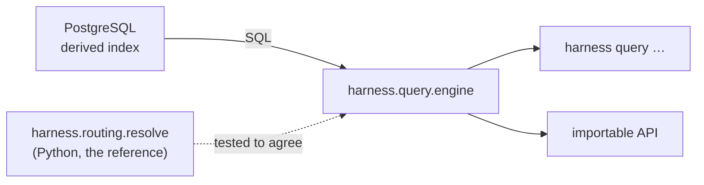

# Query API

> ID: HARNESS-QUERY-001
>
> Status: **Implemented** — build-order step 2 of `HARNESS_ARCHITECTURE.md` §9.
>
> Authority: a design document. It records how step 2 was built and holds no
> decision status. The decisions it implements are `ADR-2026-006` (derived index)
> and `ADR-2026-009` (element-wise scope matching).

---

## 1. What this is

Build-order step 2, *"the lookup surface that replaces file-reading"*. Most agent
questions are lookups wearing a costume:

| Question | Without the harness | With it |
|---|---|---|
| Which documents cover `MRB-M06-S07`? | read the tree | `harness query touching MRB-M06-S07` |
| Is this blocked? | infer | `harness query blocked MRB-M06-S07` |
| Which work items are blocked, and by what? | correlate by hand | `harness query stops` |
| What does this document depend on? | open it | `harness query links <id>` |
| What is decided about X? | read the registry | `harness query decisions` |

Each row moved from "a model answers" to "code answers" removes tokens **and** a
hallucination surface.

## 2. Shape



`harness/query/engine.py` is a thin layer over SQL, not a second model of the
data. It reads the derived index and never the working tree, so an answer is a
function of a committed revision.

## 3. The decision that shapes the schema

Scope queries must be **element matches, not substring matches**.

Storing `covers: [MRB-M06]` as JSON text and matching with `LIKE '%MRB-M06%'`
would also match `MRB-M06-S07` — silently over-selecting every child scope, which
is precisely the failure the resolver exists to prevent. So list-valued routing
fields are projected **one row per element** into `document_field_items`, and a
scope query is a join:

```sql
SELECT d.concept_id
FROM documents d JOIN document_field_items i ON i.path = d.path
WHERE i.key = 'covers' AND i.item = 'MRB-M06'
```

`MRB-M06` now selects only documents that name `MRB-M06`. See `ADR-2026-009`.

## 4. Cross-checked against the resolver

`blocked` and `touching` restate logic `harness.routing.resolve` already
implements in Python. The same question answered two ways is an opportunity to
catch a disagreement, so it is a test: the SQL answers are compared with
`resolve_context` over the same committed model, and a divergence fails.

Where the two could disagree, **the Python resolver is the reference** — it is
what an agent actually runs. The wording is kept close on purpose, so a reader
sees the same blocker in `harness context` and in `harness query blocked`.

Verified against a real consumer (`mr_bera`, 34 documents) on three work items:
`MRB-M06-S07` (three stop conditions), `MRB-M06-S14-C02` (`CONTROL-STORE-01`) and
`MRB-M02` (none). The SQL and Python answers matched exactly in all three cases.

## 5. The join §5.2 names

> Git is **not** a query engine. Asking "which modules are blocked by a
> `BlockedOwner` decision that also touches `MRB-M06-S07`" is a join, and belongs
> in SQL.

`harness query stops` is that join. On the real corpus it returns twelve
`BlockedOwner` rows — the work item, the blocker ID, the state and the title — in
one query, where correlating by hand means reading every `Unknown` concept.

## 6. Exit codes and honesty

| Code | Meaning |
|---|---|
| `0` | answered |
| `1` | the document was not found (`show`) |
| `2` | usage error — validated *before* a connection is attempted |
| `3` | the derived store is unreachable |

**Exit 3 is the important one.** Without a DSN the command refuses; it never
prints "nothing applies", which an agent would read as a fact. An unreachable
index and an empty index are different things, and the exit code distinguishes
them.

Usage errors are validated before the database is touched, so a mistyped field
name reports the mistyped field rather than a connection failure.

## 7. Deliberately not here

| Not built | Why |
|---|---|
| Semantic/vector search | the index is deliberately not a store of embeddings; a lookup is enough |
| Querying uncommitted work | git is the source of truth (step 1) |
| Any assertion about PostgreSQL version | no authoritative document fixes one (`DecisionRequired`) |
| Writing through a query | every mutation has one executor, and it is not a query |

## 8. Change history

| Version | Date | Change |
|---|---|---|
| v1.0 | 2026-10-13 | Build-order step 2 implemented: nine lookups, element-wise scope matching, resolver cross-check. |

## 9. How this is verified in CI

The index and query layers need a database, so the `test` job runs a
`postgres:16` service and the tests take their DSN from `MRB_TEST_DSN`.

Without that, the whole derived-store layer skipped in CI — which the coverage
floor exposed: coverage read 79.02% against an 80% floor while every test passed.
The floor was being enforced against code CI never ran. Suppressing those modules
in the coverage config, or lowering the floor, would both have made the number
pass by measuring less. Running the database is the fix; coverage is 91% as a
result.

`MRB_TEST_DSN` is deliberately a *separate* variable from `MRB_HARNESS_DSN`: the
fixtures call `reset`, and a fallback meant a test run could destroy a real
index. That is not hypothetical — it happened once.

